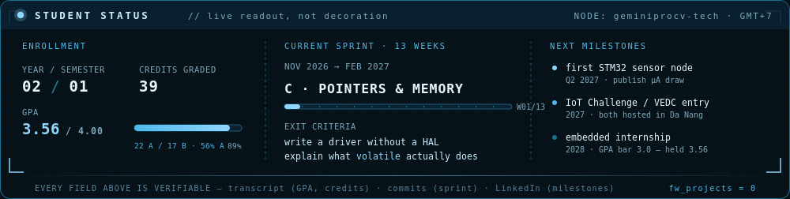

# PHỤ LỤC — 4 thứ nâng cấp (làm sau khi đã dán README)

Làm đúng thứ tự này. Mỗi bước 5–15 phút.

---

## 1. Hoạt cảnh 3 mascot (thay cho status panel cũ)

**File:** `assets/crew-walk.gif` (động, 321 KB) · `assets/crew-walk.png` (ảnh tĩnh dự phòng)
**Nguồn:** `assets/mascots/m1.png` `m2.png` `m3.png` — cả 3 đã vẽ lại theo cùng chất 3D bóng (glossy toy), tách nền trắng, hạ kích thước cho gọn repo

Ba con đứng sát nhau, **nhấp nhô theo nhịp bước lệch pha**, đi qua lại và **tự lật mặt** khi quay đầu.

### Vì sao GIF mà không phải SVG
SVG + SMIL có thể bị proxy ảnh của GitHub bỏ qua phần animation → bạn sẽ thấy một khung đứng yên.
**GIF thì luôn chạy**, và 3 mascot là ảnh raster sẵn nên không mất gì về chất lượng.

### Hiệu ứng đang bật
| Hiệu ứng | Mô tả | Tắt bằng |
|---|---|---|
| **travel** | đi qua lại, dừng 1 nhịp mỗi đầu, tự lật mặt | `AMP = 0` |
| **bob** | nhấp nhô theo nhịp bước, 3 con lệch pha | `BOB = 0` |
| **squash** | nén khi chạm đất, giãn khi lên đỉnh | `SQUASH = 0` |
| **sway** | nghiêng nhẹ qua lại | `SWAY = 0` |
| **glow** | quầng sáng sau lưng, đập theo nhịp | `GLOW_ON = False` |
| **dust** | hạt sáng bay lên, lặp đúng 1 chu kỳ | `DUST_ON = False` |
| **shadow** | bóng dưới chân, to nhỏ theo độ cao | (luôn bật) |

### Dựng lại / chỉnh
```bash
pip install pillow cairosvg
python3 tools/make-crew-gif.py
```
Hằng số ở đầu script:

| Muốn đổi | Sửa |
|---|---|
| Con nào trông nhỏ quá | `HEIGHTS = [96, 88, 66]` |
| Đứng sát / xa nhau | `CX = [315, 390, 470]` |
| Đi xa / gần | `AMP = 172` |
| File nhẹ hơn | giảm `COLORS = 48` (24 → nhẹ hơn ~30%) hoặc giảm `N = 32` |
| Nhanh / chậm | `FPS = 11`, `STEP_HZ = 2.1` |
| Nhấp nhô nhiều / ít | `BOB = 6` |
| Nghiêng nhiều / ít | `SWAY = 2.4` |
| Co giãn nhiều / ít | `SQUASH = 0.055` |
| Chữ trên khung | `LABEL_L`, `LABEL_R`, `CAPTION` |

### Vì sao file GIF nặng hơn bản không hiệu ứng
Quầng sáng là **gradient** → GIF (bảng màu 256) phải chia dải, nén kém. Đã xử lý bằng cách vẽ quầng
thành **4 dải phẳng** thay vì gradient mượt: 592 KB → 321 KB mà mắt gần như không phân biệt được.
Nếu vẫn thấy nặng, đặt `GLOW_ON = False` là về ~286 KB.

### Đổi mascot khác
1. Thay `assets/mascots/m1.png`..`m3.png` bằng ảnh nền trong suốt
2. Chạy lại script
3. Nếu nền ảnh không trong suốt: tách nền bằng https://www.remove.bg, hoặc nhờ t xử lý

### Đổi tên hiển thị
Khung hiện **không ghi tên từng con** (vì t không chắc thứ tự bạn muốn gán). Muốn ghi tên thì nói
thứ tự, hoặc tự sửa `LABEL_L` thành `CLAUDE · CHATGPT · GEMINI`.

---

## 1b. (tuỳ chọn) Status panel — ảnh thật, không phải widget bên thứ ba

**Vì sao đáng làm:** mọi widget (`github-readme-stats`, `streak-stats`, `komarev`…) đều là **dịch vụ của người khác**.
Chúng chết, bị rate-limit, hoặc hiện "Something went wrong" đúng lúc recruiter mở profile. Panel của bạn là **file trong repo → luôn hiện**.

### Dùng ngay
1. Upload `assets/status-panel.png` lên repo profile
2. Trong README, chỗ cần chèn:
   ```html
   <p align="center">
     
   </p>
   ```
3. Thẻ `alt` dài **không phải để cho đẹp** — nó là nội dung profile khi ảnh không tải được, và là thứ Google đọc.

### Sửa nội dung panel
Mở `assets/status-panel.svg` bằng text editor (nó là XML, không phải ảnh nhị phân):
- Dòng chữ → sửa trong thẻ `<text>`
- Số liệu → `YEAR / SEMESTER`, `CREDITS GRADED`, `GPA`, `22 A / 17 B`
- Sprint → `CURRENT SPRINT`, `EXIT CRITERIA`
- Thanh GPA: `width="121"` trong `<rect x="170" y="158" ...>` = (GPA/4)×136. GPA 3.56 → 121.
- Thanh tuần: `width="20"` trong `<rect x="360" y="132" ...>` = (tuần/13)×288

### Render lại ra PNG
```bash
pip install cairosvg
python3 -c "import cairosvg; cairosvg.svg2png(url='assets/status-panel.svg', write_to='assets/status-panel.png', output_width=1000)"
```
Không cài được? Mở SVG bằng trình duyệt → chụp màn hình → hoặc dùng https://cloudconvert.com/svg-to-png.

> **Quy tắc số một:** nếu số trong panel khác số trong transcript, bạn đã tự tạo ra một lời nói dối.
> Sửa transcript thì sửa panel. Không có ngoại lệ.

---

## 2. Social preview — thứ hiện ra khi ai đó share profile bạn

Khi bạn gửi link `github.com/geminiprocv-tech` qua Zalo/LinkedIn/Discord, nó hiện một **thẻ ảnh**. Mặc định là avatar ảnh vuông nhỏ xíu.

Đổi thành ảnh 1280×640:
1. Vào repo profile → **Settings** (tab của repo, không phải settings tài khoản)
2. Kéo xuống **Social preview** → **Edit** → upload `assets/social-preview.png`
3. Xong. Từ giờ mọi link share đều hiện ảnh này.

Ảnh đã có sẵn trong `assets/social-preview.png` (1280×640, đúng chuẩn). Muốn sửa: `assets/social-preview.svg`.

---

## 3. NOW tự cập nhật bằng GitHub Actions

**Vì sao đáng làm:** đây là thứ duy nhất trên profile chứng minh **bạn còn đang chạy**, không phải ảnh chụp năm ngoái. Và nó là **Tầng 4 (CI/CD) trong lộ trình học** — bạn đang tập nó thật, không phải học trên slide.

### Cách bật (3 phút)
```
repo profile/
├── now.json                              ← nguồn sự thật duy nhất
├── README.md                             ← có <!-- NOW:START --> ... <!-- NOW:END -->
└── .github/workflows/update-readme.yml   ← máy ghi vào giữa 2 marker
```
1. Tạo thư mục `.github/workflows/` trong repo profile
2. Upload `now.json` và `update-readme.yml` (giữ đúng đường dẫn)
3. Đảm bảo README có 2 marker `<!-- NOW:START -->` và `<!-- NOW:END -->`
4. Vào **Settings → Actions → General → Workflow permissions** → chọn **Read and write permissions** → Save
5. Tab **Actions** → chọn workflow → **Run workflow** (chạy tay lần đầu để chắc nó hoạt động)
6. Sau đó: chỉ sửa `now.json`, mọi thứ tự chạy. Cũng tự chạy mỗi thứ Hai 08:00 giờ Đà Nẵng.

### Mỗi tuần bạn chỉ sửa 3 chỗ trong `now.json`
```json
"sprint": { "name": "...", "week": 2, "of": 13 },
"metrics": { ... },
"next": [ ... ]
```

**Đây là điểm khác biệt thật:** 99% sinh viên có profile tĩnh. Bạn có profile có **pipeline**.

---

## 4. CV — PDF 1 trang, cùng bộ màu

- `cv/cv.pdf` — bản in được ngay, 1 trang A4
- `cv/cv.html` — bản nguồn. Sửa xong render lại bằng:
  ```bash
  pip install weasyprint
  python3 -c "from weasyprint import HTML; HTML(filename='cv/cv.html').write_pdf('cv/cv.pdf')"
  ```
- Hoặc mở `cv.html` bằng Chrome → Ctrl+P → *Save as PDF* → Margins: **None** → **bỏ** "Headers and footers"

### 7 chỗ phải sửa trước khi gửi
1. `YOUR FULL NAME`
2. `UNIVERSITY NAME` + `Expected 2029`
3. Email
4. LinkedIn handle
5. GPA / credits / số A-B (nếu đã qua học kỳ mới)
6. Tên project (nếu đổi)
7. Ngày cập nhật ở footer

Sau khi sửa: upload `cv.pdf` lên repo profile (cùng chỗ README) để badge CV trong README trỏ tới đúng file.

> **Điểm mạnh của CV này:** nó ghi *"No finished firmware project yet, and this CV says so."*
> Nhiều người sợ dòng đó. Nhưng người phỏng vấn đọc 200 CV một tuần — cái họ nhớ là
> **người không thổi phồng**. Và khi bạn có project thật, độ tin của cả CV tăng gấp đôi.

---

## Thứ tự làm

| | Bước | Thời gian | Tác động |
|:--:|---|:--:|---|
| 1 | Dán `README-v4-NAM2.md` + upload `status-panel.png` | 10 phút | ⭐⭐⭐⭐⭐ |
| 2 | Upload `cv.pdf` | 2 phút | ⭐⭐⭐⭐ |
| 3 | Bật Social preview | 3 phút | ⭐⭐⭐⭐ |
| 4 | Bật Action + `now.json` | 10 phút | ⭐⭐⭐⭐⭐ |
| 5 | Bật `NOW.md` làm file công khai | 1 phút | ⭐⭐⭐ |
| 6 | Sửa `now.json` mỗi tuần | 2 phút/tuần | ⭐⭐⭐⭐⭐ (dài hạn) |

Bước 6 là bước quan trọng nhất và là bước duy nhất phải làm **mãi mãi**. Bốn bước đầu chỉ là dựng sân.
