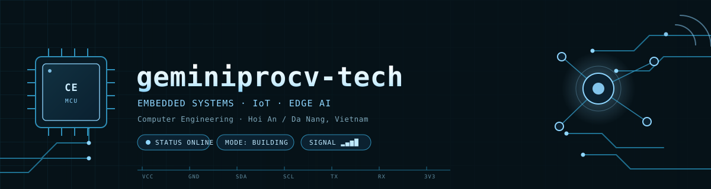

<!--
  PROFILE README — dán vào repo: geminiprocv-tech/geminiprocv-tech (repo PUBLIC, tên trùng username)
  Banner: mặc định dùng assets/banner.svg (nền tối, xanh nhạt làm điểm nhấn — hiển thị tốt ở cả dark & light mode)
          muốn nền sáng hoàn toàn thì đổi thành assets/banner-lite.svg
  Chỗ nào có <!-- EDIT --> là phải sửa theo dữ liệu thật.
-->

<p align="center">
  
</p>

```console
geminiprocv@edge-node:~$ ./boot.sh
[    0.000] Booting geminiprocv-tech v1.0 ...................... OK
[    0.214] Mounting /skills ....................... 8 modules
[    0.402] Probing I2C bus 0 ......................... 3 devices found
[    0.611] Calibrating sensors ......................... stable
[    0.800] Loading model (int8, on-device) ............. 24 fps
[    1.000] Target profile: EMBEDDED · IoT · EDGE AI
[    1.002] Status: online — building, learning, shipping
```

<h3 align="center">I build small machines that sense the world, think locally, and talk over the wire.</h3>

<p align="center">
  
  
  
</p>

<p align="center">
  
</p>

## 🛰 Device status

| FIELD | VALUE |
|---|---|
| `DEVICE_ID` | **geminiprocv-tech** |
| `ROLE` | Computer Engineering student |
| `LOCATION` | Hoi An / Da Nang, Vietnam |
| `PRIMARY_BUS` | Embedded firmware · IoT systems · Edge AI |
| `CURRENT_MISSION` | Building an end-to-end sensor → edge AI → cloud system |
| `UPTIME` | learning since 2024 <!-- EDIT --> |
| `STATUS` | 🟢 online — open to internship & junior roles |

## ⚡ Bus topology — what I work with

**MCU / boards**
<br/>


**Languages**
<br/>


**Protocols**
<br/>


**Infra & tools**
<br/>


<p align="center">
  
</p>

## 📡 Active nodes — projects

> Mỗi dòng = một thiết bị trong mạng. Thay bằng dự án thật (xóa dòng mẫu khi đã có).
> **Quy tắc kể:** nêu *số đo được* — dòng điện sleep, FPS, độ trễ, kích thước model, uptime.

| NODE | STACK | TELEMETRY | STATUS |
|---|---|:--:|:--:|
| [**sensor-node**](https://github.com/geminiprocv-tech) <!-- EDIT --> | `C` `STM32` `I2C` `MQTT` | sleep **42 µA**, battery **9 days** | 🟢 done |
| [**edge-vision**](https://github.com/geminiprocv-tech) <!-- EDIT --> | `Python` `YOLOv8n` `TensorRT` | **24 FPS** after INT8, model **6.1 MB** | 🟡 wip |
| [**iot-dashboard**](https://github.com/geminiprocv-tech) <!-- EDIT --> | `Java` `Spring` `PostgreSQL` | p95 **85 ms**, **1.2 M** rows/day | 🟡 wip |
| [**node-infra**](https://github.com/geminiprocv-tech) <!-- EDIT --> | `Docker` `CI/CD` `Prometheus` | deploy **1 command**, pipeline **92 s** | 🔵 planned |

<p align="center">
  
</p>

## 📈 Telemetry

<p align="center">
  
  
</p>

<p align="center">
  
</p>

<p align="center">
  
</p>

<p align="center">
  
</p>

## 🔌 Pinout — get in touch

| PIN | SIGNAL |
|:--:|---|
| `TX` | [](https://www.linkedin.com/in/YOUR-HANDLE) <!-- EDIT --> |
| `RX` | [](mailto:YOUR@EMAIL.COM) <!-- EDIT --> |
| `GND` | Da Nang, Vietnam (GMT+7) |
| `3V3` | Open to **internship** & **junior embedded / edge AI** roles |

<br/>

<p align="center">
  <i>"If it doesn't have a debug LED and a log line, it doesn't exist."</i>
</p>

<p align="center">
  
</p>
