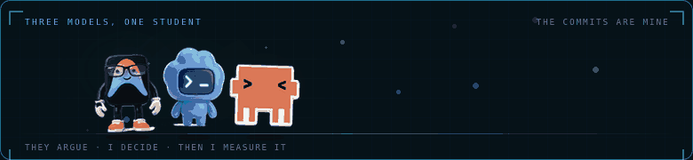

<div align="center">

<a href="https://github.com/geminiprocv-tech">
  
</a>

**I am early. That is the point — I am telling you where I am, not where I pretend to be.**

<a href="mailto:YOUR@EMAIL.COM"></a>
<a href="https://www.linkedin.com/in/YOUR-HANDLE"></a>
<a href="cv.pdf"></a>
<a href="https://github.com/geminiprocv-tech"></a>



</div>

---

## 🎯 About Me

```c
typedef struct {
    const char *name;
    const char *role;
    const char *location;

    uint8_t  year            : 3;   /* 2  — second year, semester 1       */
    uint8_t  credits_done    : 7;   /* 39 graded credits so far           */
    uint8_t  gpa_x10         : 6;   /* 35 -> 3.56 / 4.0                   */
    uint8_t  fw_projects     : 4;   /* 0  — honest. First node: Q2 2027   */
    uint8_t  open_to         : 1;   /* 1  — embedded internship, 2028     */

    const char *strengths[3];
} student_t;

static const student_t me = {
    .name      = "geminiprocv-tech",
    .role      = "Computer Engineering student, learning embedded firmware",
    .location  = "Da Nang, Vietnam (GMT+7)",
    .strengths = {
        "Object-oriented programming — strongest subject, grade A",
        "Reading English datasheets and documentation without help",
        "Finishing what I start: 56% of my graded courses are A",
    },
};
```

> [!NOTE]
> `fw_projects = 0` là **cố ý**. Nó trung thực và nó đặt kỳ vọng đúng chỗ — người đọc xong sẽ thấy tôi tỉnh, không phải thấy tôi yếu.

## 📡 Now

<!-- NOW:START -->
<!-- NOW:END -->

> [!TIP]
> Khối trên **do máy ghi** — sửa `now.json`, GitHub Actions tự cập nhật. Đây là chỗ duy nhất trên profile chứng minh tôi còn đang chạy, không phải ảnh chụp từ năm ngoái.
>
> Kế hoạch 90 ngày đầy đủ, gồm 3 checkpoint và danh sách thứ **cố tình không học**: **[NOW.md](NOW.md)**

## 📍 Where I am right now

- **Second-year Computer Engineering student in Da Nang**, semester 1. 39 graded credits, GPA **3.56/4.0**.
- **Comfortable with:** OOP and Java, web basics, SQL, Git. These are the courses where I got A, and where I can already build something small end-to-end.
- **Working through the hard part now:** C pointers and manual memory, then registers and peripherals on a real board. Not there yet, and not pretending otherwise.
- **No firmware project on this profile yet.** I would rather leave this empty than fill it with a LED-blink repo and call it experience.

## 🗺️ What I am working toward

| When | What | Why it matters |
|---|---|---|
| **Now → 06/2027** | C from the bottom: pointers, memory, bit manipulation. Then a first STM32 board: GPIO, UART, one I²C sensor. | Without C at this level, every embedded interview stops at question one. |
| **2027** | FreeRTOS tasks and queues, MQTT uplink, a sensor node that runs on battery and logs its own current draw. | The first project I will be able to put a *measured* number on. |
| **2027–2028** | Enter **IoT Challenge** and **VEDC** as a team member — both in Da Nang. | Competition deadlines are the only thing that reliably forces a project to finish. |
| **2028** | **Embedded firmware internship** — Hitachi Digital Services Da Nang is the target (GPA bar 3.0; mine is 3.56). | This profile exists so that when I apply, there is something to read. |
| **Capstone** | One system, four layers: firmware → edge model → backend → CI/CD. Not four separate demos. | One deep project beats five shallow ones. |

## 🛠️ Tech Stack

**✅ Comfortable — I have built something with these**


**📖 Learning right now — coursework or self-study, no project yet**


**🗺️ Planned, with a date attached — not claimed yet**

-1c7fb0?style=flat-square&logo=freertos&logoColor=white)
-1c7fb0?style=flat-square&logo=espressif&logoColor=white)
-1c7fb0?style=flat-square&logo=mqtt&logoColor=white)
-1c7fb0?style=flat-square&logo=docker&logoColor=white)

## 🧭 How I work

Ba con AI cãi nhau với tôi mỗi ngày — Claude, ChatGPT, Gemini. Chúng đưa ra lựa chọn; **commit, bài test và con số đo được là của tôi.** Đây là 5 luật tôi giữ để điều đó đúng:

| Rule | What it looks like in practice |
|---|---|
| **Datasheet before search** | Reference manual first, forum second. Nếu không tìm thấy trong tài liệu, bản thân điều đó cũng là thông tin |
| **Type it, don't paste it** | Mọi driver tôi gõ tay, rồi **cố tình làm hỏng**, rồi sửa. Copy-paste giấu đúng phần tôi cần hiểu |
| **Measure before believing** | µA đến từ đồng hồ vạn năng, không đến từ một dòng trong datasheet nói "typical" |
| **One commit a week, with what broke in the message** | `w04: ring buffer lost a byte past 128 — off-by-one in head wrap` |
| **Definition of done before starting** | Nếu tôi không nói được "xong nghĩa là gì", tôi chưa bắt đầu |

Cách tôi dùng AI: nhờ nó giải thích một đoạn errata, hỏi ngược "tại sao cách này sai", sinh bài test cho hàm ring buffer. Không nhờ nó viết xong project hộ. **Thứ tôi nộp là thứ tôi giải thích được.**

## 🎯 2027 Goals

- 🧱 Write C until pointers and manual memory stop being scary — then write a driver without a HAL
- 🔌 Get **one** sensor node running on a battery, and publish how many µA it draws
- 🏆 Join a team for **IoT Challenge** or **VECD** — both hosted in Da Nang
- 📚 Turn the two B's I am unhappy with into things I can actually use (DSA, circuits)
- ✍️ One write-up per project, including the part that did not work

## 🤝 What I can offer a team right now

I am not going to claim experience I do not have. What I do have, today:

- **A foundation that will not need re-teaching** — OOP, data basics, and web, at A level
- **English good enough to read a datasheet, an errata sheet, and a GitHub issue** without a translation tool
- **A record of finishing** — 56% A across 39 credits, in a curriculum that is not easy
- **Honest reporting** — this profile says "0 firmware projects" out loud. I would rather be corrected than caught

<div align="center">

📫 **[YOUR@EMAIL.COM](mailto:YOUR@EMAIL.COM)** · 🌐 **[LinkedIn](https://www.linkedin.com/in/YOUR-HANDLE)**

<sub>Da Nang, Vietnam (GMT+7) · open to embedded internship from 2028</sub>

<br/>


<i>"Say where you are. Then move."</i>

</div>
